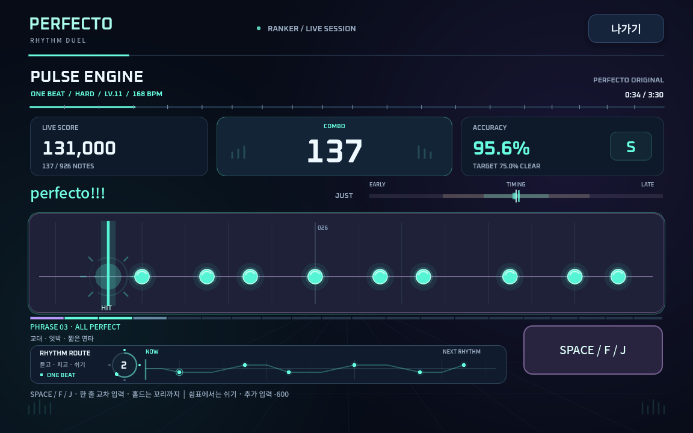
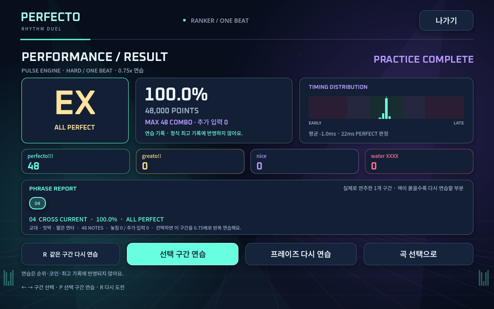

# 플레이 가이드

## 리듬 제작

첫 키 입력부터 시간을 기록합니다. 짧게 눌렀다 떼면 일반 노트, 0.3초 이상 유지하면 롱 노트입니다. 전체 예산은 8개이며 롱 노트는 유지 시간의 올림만큼 사용합니다. 예를 들어 1.2초는 2개, 3초는 3개입니다. 마지막 롱 노트가 남은 예산을 채우면 자동으로 끝냅니다.

노트 사이에는 최소 80ms 간격을 둡니다. 제작은 첫 입력부터 최대 30초입니다. 대전에서는 공수 시작 후 제작에 45초, 완성된 리듬 확인에 최대 90초를 주며, 다시 만들기를 반복하더라도 한 공격 준비 전체는 150초를 넘기지 못합니다. 화면의 남은 시간을 확인하세요.

8개를 채우면 전체 리듬을 한눈에 보고 다음 동작을 선택합니다.

| 동작 | 버튼 / 단축키 |
|---|---|
| 리듬을 들으며 확인 | 미리듣기 / P |
| 미리듣기 중지 | 중지 / P |
| 처음부터 다시 제작 | 다시 만들기 / R |
| 공격 전송 또는 따라 치기 시작 | 전송 / Enter |
| 기기에 저장 | 보관함에 저장 |

보관함에는 서로 다른 리듬을 최대 8개 저장합니다. 대전에서는 아직 노트를 만들지 않았을 때 **내 비트 가져오기**로 선택할 수 있습니다. 보관함의 삭제는 해당 기기의 저장 리듬을 삭제합니다.

## 수비

4초 카운트다운 뒤 노트가 판정선으로 이동합니다. 선택한 입력 키를 누르거나 화면의 큰 입력 버튼을 사용하세요. 롱 노트는 시작에 누르고 꼬리가 닿을 때 뗍니다.

롱 노트를 누르는 동안 판정선 주변의 링이 채워지고 남은 유지 시간이 표시됩니다. 제작 화면에서는 키를 누른 즉시 노트가 나타나고, 유지 중인 롱 노트의 예상 사용량도 함께 표시합니다.

놓치지 않고 맞추면 콤보가 쌓입니다. 놓치거나 맞지 않는 타이밍에 추가로 누르면 연속 콤보가 끊깁니다. 롱 노트의 콤보는 끝까지 판정한 뒤 반영합니다. 타이밍 피드백은 EARLY / LATE로 표시하고, 롱 노트는 시작과 끝 중 오차가 큰 쪽을 사용합니다.

오차 허용 구간은 원본 리듬 기준 35 / 80 / 180ms입니다. 배속이 빨라지면 실제 시간의 허용 구간도 그만큼 짧아집니다. 판정별 기본 점수는 1000 / 700 / 400 / 0이고, 롱 노트에는 예산 가중치를 적용합니다. 추가 입력은 200점씩 감점하되 점수는 0 아래로 내려가지 않습니다.

점수는 최대 8000점인 한 공수의 수비를 기준으로 누적합니다. 콤보에 따른 추가 점수 배수는 없으므로 롱 노트 구성과 콤보 수 때문에 기본 점수의 상한이 달라지지 않습니다.

## 결과 화면

- 정확도: 실제 획득 점수 ÷ 최대 점수. 추가 입력 감점도 반영합니다.
- 등급: S 95% / A 85% / B 70% / C 50% / D 그 미만.
- FULL COMBO: 모든 노트를 놓치지 않고 추가 입력도 없는 경우.
- ALL PERFECT: 모든 노트가 perfecto이고 추가 입력이 없는 경우.
- 최대 콤보: 놓침과 추가 입력으로 구분된 연속 성공의 최대 길이.
- 오차 그래프: 가운데는 정확한 입력, 왼쪽은 빠른 입력, 오른쪽은 늦은 입력입니다. 롱 노트는 시작과 끝 중 큰 오차를 표시합니다. 범위를 넘는 오차는 그래프 끝에 표시합니다.

온라인 대전에서는 서버가 계산한 최종 결과를 양쪽에 보여줍니다. 공격자는 상대의 수비 결과를, 수비자는 자신의 결과를 봅니다. 누적 점수가 높은 사람이 이기고 같으면 무승부입니다.

둘 다 **한 판 더**를 선택하면 설정을 유지해 재대전하며, 첫 공격자를 번갈아 바꿉니다. 상대가 종료 후 나가도 결과 화면은 유지합니다. 경기 도중 나가면 상대가 승리하며, 중도 이탈 경기에는 코인을 지급하지 않습니다.

## 혼자하기 · 연습 맵

메인의 **혼자하기 · 맵**에서 12개 고정 맵을 선택합니다. 각 맵은 약 23~36초의 연속 플레이이며 별도의 4초 카운트다운이 있습니다. 8개 노트씩 끊어지는 코스와 달리 한 맵을 끝까지 연주합니다.

| 구역 | 맵 | 연습 내용 |
|---|---|---|
| MINT START | 첫 빛, 포켓 그루브, 작은 발걸음, 네온 산책 | 정박·쉬는 박자·짧은 연타 |
| HOLD VALLEY | 길게 숨쉬기, 빛의 다리, 신호 교차로, 프리즘 게이트 | 유지·떼기·홀드와 탭 전환 |
| PRISM CITY | 스윙 시티, 빠른 손끝, 글라스 스톰, 퍼펙트 스카이 | 엇박자·빠른 연타·혼합 패턴 |

**맵 플레이**는 원래 속도 1.0배로 도전합니다. 정확도 60%부터 클리어하고 별 1개로 다음 맵이 열립니다. 80%는 별 2개, 95%는 별 3개입니다. 최고 기록과 해금은 이 기기에 저장됩니다. 잠긴 맵을 눌러도 미리보기와 연습은 가능합니다.

**연습하기**는 선택한 0.5~1.25배로 플레이하고 가이드음을 켜거나 끌 수 있습니다. 가이드음은 노트 시점을 알려주지만 입력과 점수를 대신 만들어주지 않습니다. 느린 연습은 정식 기록·별·맵 해금에 반영되지 않습니다. 반주와 가이드음은 설정의 볼륨을 따릅니다.

맵은 INTRO → GROOVE → BRIDGE → FINALE 구간으로 이어집니다. ESC로 연습과 정식 혼자하기를 일시정지할 수 있습니다. 결과에서 재도전·다음 맵·맵 선택으로 이동하며, 마지막 맵을 클리어한 뒤에는 모든 별과 ALL PERFECT에 도전해 보세요. 온라인 코인·레이팅과는 별개입니다.

## 랭커 아레나 · RHYTHM RE:FORM V2

**RANKER ARENA**는 3~4분 길이의 오리지널 4곡을 연주하는 고난도 모드입니다. ONE BEAT·DOUBLE 각각 HARD·EXPERT·INFERNO를 선택할 수 있어 총 24개 채보를 제공합니다. ONE BEAT는 SPACE/F/J로 같은 줄을 치며, DOUBLE은 F로 위 줄, J로 아래 줄을 칩니다. DOUBLE에서는 두 줄을 동시에 치거나 한 줄을 유지하면서 반대 줄의 리듬을 연주할 수 있습니다.

V2 채보는 같은 음악 악보의 중심 멜로디·응답·장식음을 난이도별로 연주하도록 구성했습니다. 반복되는 구절을 듣고 익힌 뒤 엇박, 셋잇단, 짧은 연타와 홀드로 변주합니다. 쉼표에서는 손을 멈추고 다음 응답을 기다리세요. 빠른 구간의 전후에도 쉬는 박이 있습니다.

### 화면 읽기

상단에서 곡의 재생 시간·진행률을, 그 아래에서 점수·큰 콤보·정확도·등급을 확인합니다. 이전 기록이 있다면 최고 정확도를 목표로 표시합니다. 판정 옆의 EARLY/LATE와 타이밍 막대는 최근 입력이 얼마나 빠르거나 늦었는지 보여줍니다.

노트가 닿는 판정선은 고정되어 있습니다. 뒤의 격자는 실제 곡의 마디·강박·반박에 맞춰 흐릅니다. 현재 BPM과 박자표, 연주 중인 프레이즈, 곧 나올 기법과 템포 변화를 확인할 수 있습니다. IRREGULAR ORBIT에서는 3박·4박·5박 마디가 섞입니다.

아래 **RHYTHM ROUTE**는 다음 리듬 사이의 시간 간격을 보여줍니다. 민트는 첫 줄, 보라는 DOUBLE의 두 번째 줄이며, 긴 선은 홀드입니다. `REST`는 쉬는 구간, `HOLD`는 유지 중임을 알려줍니다. 박자 표시와 노트 이동은 음악 재생 시계를 따릅니다. 설정의 움직임 줄이기는 장식 움직임을 줄이며, 음악·판정·필수 노트 이동은 유지합니다.

누를 때 짧고 잔향이 적은 입력음과 판정선의 빛이 반응합니다. 프레이즈를 끝까지 연주하면 해당 구간의 ALL PERFECT·FULL COMBO 등 결과가 잠시 표시됩니다. 구간 진행 막대에서도 완료한 프레이즈의 결과를 확인할 수 있습니다. 이 화면과 효과의 개선은 기존 V2 음악·채보·점수 규칙을 바꾸지 않습니다.

### 구간을 익히기

1. 곡·종목·난이도를 선택합니다. 키보드에서는 ↑/↓로 곡, ←/→로 종목, Q/E로 난이도를 바꿉니다.
2. 연습 구간에서 **전체 곡**, **SECTION 01~04**, 또는 기법 이름이 붙은 짧은 프레이즈를 고릅니다. 프레이즈는 8마디 중심이며 섹션 끝의 일부 구간은 더 짧습니다.
3. **곡 미리듣기**로 선택 구간을 최대 18초 듣습니다. 전체 곡을 선택했을 때는 첫 드롭부터 재생합니다. 옆의 리듬 미리보기도 선택 구간을 따릅니다.
4. 연습 속도 **0.50x / 0.75x / 1.00x**를 정하고, 계속 익히려면 **선택 구간 반복**을 켭니다.
5. **구간 연습** 또는 **P**로 시작합니다. 반복할 때마다 카운트다운 후 같은 음악과 채보가 재생됩니다. 반복 횟수와 이번 연습의 최고 정확도가 표시됩니다.

| 연습 중 동작 | 조작 |
|---|---|
| 현재 구간 처음부터 다시 | R |
| 반복을 끄고 이번 구간 결과 보기 | L 또는 반복 끄기 버튼 |
| 일시정지·재개 | ESC |

반복을 끄면 현재 시도는 계속되고 구간 끝에서 결과를 보여줍니다. 연습 속도·구간·반복 설정은 정식 도전에 적용되지 않습니다. 연습은 기록판·POWER·첫 클리어 보상을 변경하지 않습니다.

### 정식 도전과 점수

**기록 도전 / Enter**는 원래 속도로 곡 전체를 시작합니다. perfecto / greato / nice의 판정 오차는 아래와 같습니다. 롱 노트는 시작과 끝 중 더 큰 오차를 사용합니다.

| 난이도 | perfecto | greato | nice |
|---|---|---|---|
| HARD | 22ms | 50ms | 100ms |
| EXPERT | 20ms | 45ms | 90ms |
| INFERNO | 18ms | 40ms | 80ms |

맞지 않는 타이밍에 추가로 누르면 **입력당 600점 감점**과 콤보 초기화가 적용됩니다. 플레이 중의 정확도에도 감점이 반영되며 점수는 0 아래로 내려가지 않습니다. 친구 대전의 감점은 기존 **200점**입니다. 랭커도 콤보 자체의 추가 점수 배수는 없습니다.

정확도 **75%부터 클리어**합니다. 등급은 EX 99.5% / SS 98% / S 95% / A 85% / B 75%이며 그 미만은 F입니다. 모든 노트를 놓치지 않고 추가 입력이 없어야 FULL COMBO이고, 전부 perfecto이면 ALL PERFECT입니다.

정식 도전 중에는 일시정지할 수 없습니다. 창을 벗어나면 플레이를 멈추고 연습으로 전환하며, 그 시도는 정식 기록으로 등록되지 않습니다. **노트 0.8x~1.4x** 설정은 화면의 이동 속도만 바꾸고 음악 재생 속도와 판정은 바꾸지 않습니다.

기기 최고 기록·콤보·POWER·글로벌 순위는 곡·종목·난이도·채보 버전별로 구분됩니다. V2는 이전 기록을 삭제하지 않고 별도로 저장합니다. 로그인과 계정 저장소가 준비된 경우 서버가 전체 입력을 다시 채점하고 글로벌 기록을 저장합니다. 곡·종목·난이도·채보 버전별 첫 정식 클리어는 40코인입니다. 구버전 게임을 열어 둔 상태라면 새로고침한 뒤 도전하세요.

정식 도전에서 얻은 **FULL COMBO·ALL PERFECT 표시**는 해당 기기에 누적 저장됩니다. 최고 점수를 갱신하지 않은 시도에서 달성해도 남으며, 이후 실패해도 사라지지 않습니다. 연습 기록은 이 표시를 갱신하지 않습니다.

### 연주 결과에서 다시 연습하기

결과 화면은 실제 입력의 타이밍 분포와 평균 오차, 프레이즈별 정확도·놓침·추가 입력을 보여줍니다. 타이밍 분포의 왼쪽은 빠른 입력, 오른쪽은 늦은 입력입니다. 일부만 연주한 프레이즈는 부분 연습으로 표시하며, 프레이즈 전체를 완료해야 AP·FC를 받을 수 있습니다.

1. 가장 약한 프레이즈가 먼저 선택됩니다. 다른 구간은 클릭하거나 **←/→**로 고릅니다.
2. **P / 선택 구간 연습**을 누르면 선택한 프레이즈를 **0.75배속으로 반복**합니다. **약한 구간 연습** 버튼은 가장 약한 구간으로 바로 이동합니다.
3. 반복 중 **R**로 다시 시작하거나, **L**로 이번 구간이 끝난 뒤 결과를 확인합니다. 연습은 정식 기록·POWER·보상에 반영되지 않습니다.

## 아케이드 코스

### 첫 번째 비트

0.8배로 시작하는 일정한 간격의 입문 코스입니다. 3웨이브 동안 조금씩 빨라지고 마지막에는 롱 노트가 섞입니다.

### 길게, 더 길게

일반 노트와 롱 노트를 번갈아 연습합니다. 처음 누르는 타이밍뿐 아니라 떼는 타이밍도 맞춰봐요.

### 엇박자의 매력

짧은 간격과 긴 간격을 번갈아 넣은 코스입니다. 노트를 보며 일정한 손버릇을 벗어나보세요.

### 스피드 러너

1.4배에서 시작하는 빠른 코스입니다. 일반 노트와 롱 노트가 섞이고 웨이브마다 더 빨라집니다.

### 끝없는 앙코르

에너지 100으로 시작하는 생존 모드입니다. perfecto는 에너지 +3, greato는 유지, nice는 -4, 놓침은 -24입니다. 추가 입력은 -10입니다. 에너지는 0~100 범위이며 0이 되면 종료합니다. 웨이브마다 0.08배 빨라지고 최대 2.5배까지 올라갑니다.

### 오늘의 챌린지

한국 시간의 날짜를 기준으로 모두에게 같은 리듬을 만드는 3웨이브 코스입니다. 날짜가 바뀌면 새 리듬과 새 기록 칸으로 도전합니다. 순위표나 서버 보상은 없고 개인 기기 기록으로 남습니다.

일반 코스의 합산 정확도가 60% 이상이면 클리어하고, ★ 60% / ★★ 80% / ★★★ 95%를 얻습니다. 점수가 더 높거나 동점에서 최대 콤보가 좋아지면 최고 기록을 갱신합니다. 생존 모드에는 정해진 최종 웨이브가 없습니다.

## 내 손에 맞추기

설정에서 SPACE / D / F / J / K를 고릅니다. 화면 입력 버튼은 선택한 키와 같은 동작을 합니다. 입력 보정은 -150~+150ms이며, 음수는 입력을 더 빠르게 계산하고 양수는 더 늦게 계산합니다. 결과가 계속 LATE로 나온다면 음수 방향으로 조금씩 조절해 보세요.

메트로놈은 리듬 제작 때 선택한 BPM으로 들립니다. 입력 간격 자체를 양자화하거나 자동 보정하지 않습니다. 볼륨, 입자 효과, 움직임 줄이기도 조절할 수 있습니다. 연습에서는 ESC로 일시정지하고, 대전은 상대가 있으므로 일시정지하지 않습니다.

연습 기록·설정·저장 리듬은 해당 기기에 저장됩니다. 브라우저 저장을 삭제하거나 다른 기기로 옮기면 자동으로 따라오지 않습니다. 저장이 차단된 브라우저에서는 현재 창 안에서만 유지될 수 있습니다. 온라인 계정의 코인·레이팅·구매 스킨은 외부 PostgreSQL에 별도로 저장합니다.
