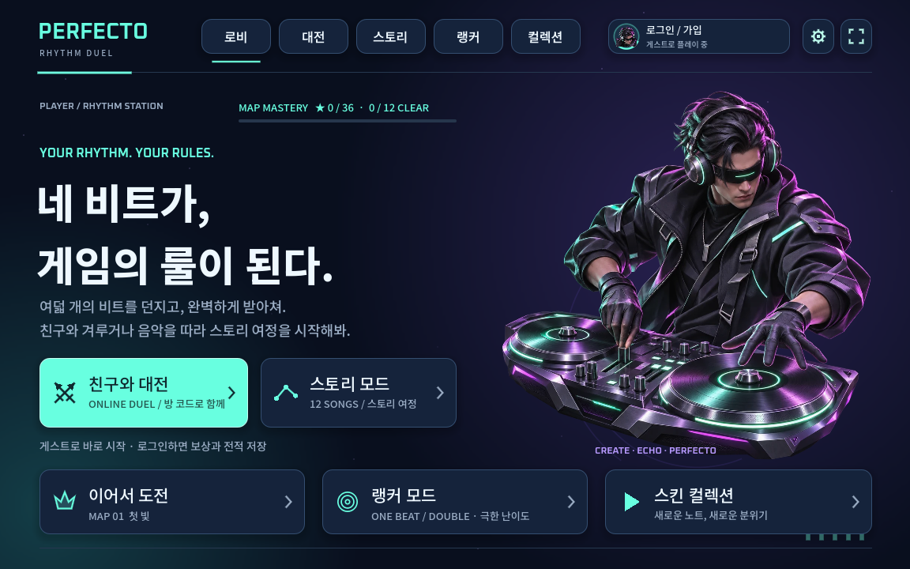
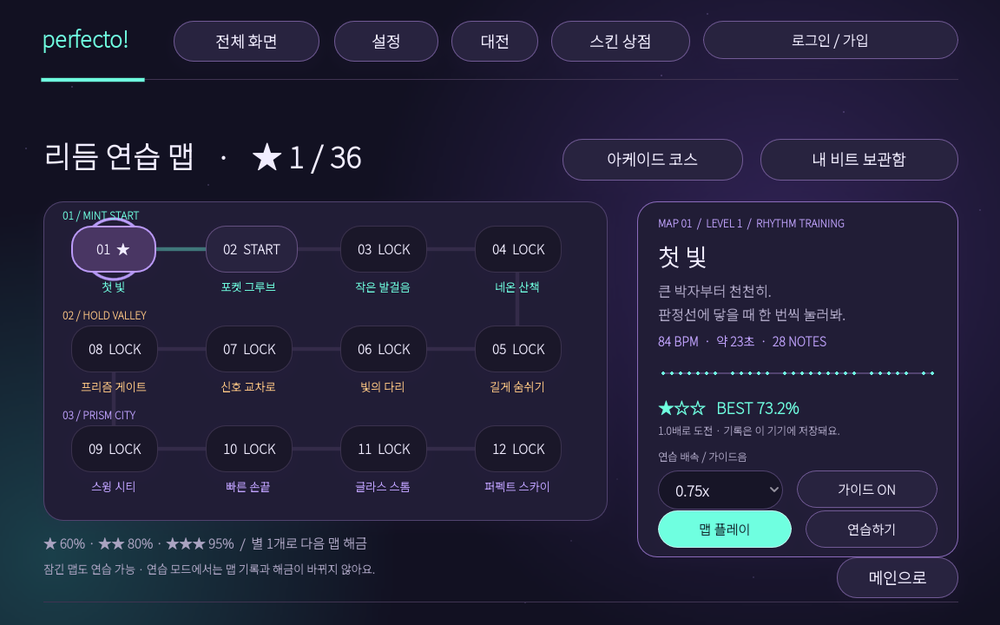
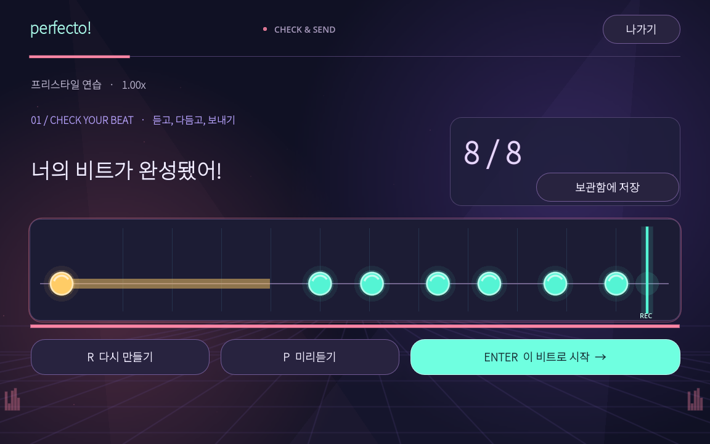
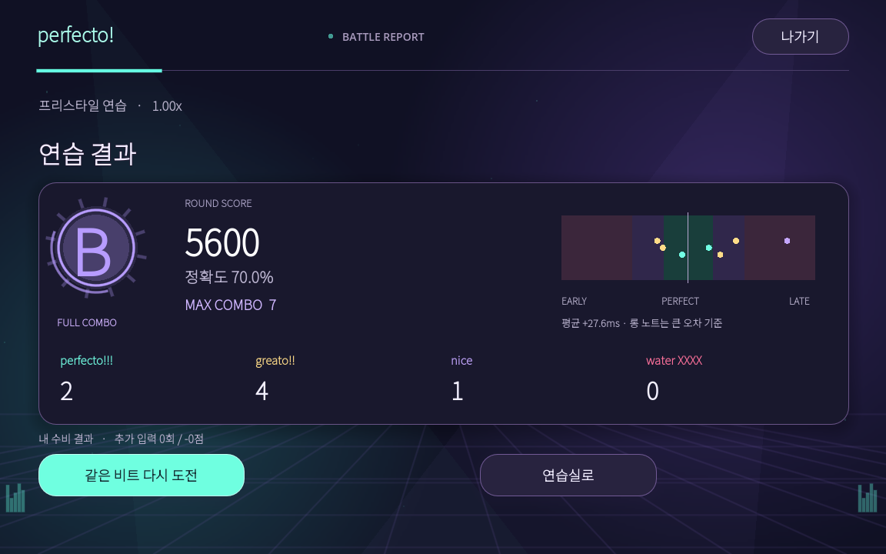

# perfecto! · Rhythm Duel

키보드로 만든 여덟 개의 비트를 친구에게 보내고, 상대의 리듬을 받아치는 고돗 리듬 대전 게임입니다.

**게임 주소:** https://rhythm-duel.onrender.com

최신 커밋의 Render 배포가 완료된 뒤 적용됩니다. 친구는 고돗을 설치하지 않고 브라우저에서 플레이할 수 있습니다.





<details>
<summary>리듬 제작·결과 화면 보기</summary>




</details>

## 친구와 시작하기

1. 두 사람이 게임 주소를 열고 **친구와 대전**을 선택합니다.
2. 방장은 모드·라운드 수·시작 배속을 골라 방을 만들고 6자리 코드를 공유합니다.
3. 친구가 코드로 참가하면 방장이 **대전 시작**을 누릅니다.
4. 공격자는 입력 키를 짧게 또는 길게 눌러 기본 예산 8개로 리듬을 만듭니다.
5. **미리듣기 → 다시 만들기 또는 전송**으로 공격을 확정합니다.
6. 수비자는 카운트다운 후 노트가 판정선에 닿을 때 따라 누릅니다. 롱 노트는 꼬리가 닿을 때까지 유지합니다.
7. 공수를 번갈아 맡고 누적 점수로 승패를 가립니다. 경기 후 둘 다 **한 판 더**를 누르면 방을 다시 만들지 않고 재대전합니다.

입력은 기본 **SPACE**이며 설정에서 D/F/J/K로 바꿀 수 있습니다. 화면의 큰 입력 버튼도 누르거나 길게 유지할 수 있습니다. 작은 화면은 가로 모드를 권장합니다.

## 플레이 콘텐츠

- **일반전:** 1~9라운드, 시작 0.5~2.0배 선택, 라운드당 +0.15배.
- **스피드전:** 같은 사용자 설정, 라운드당 +0.30배.
- **랭크전 β:** 양쪽 로그인 필수, 3라운드·1.0배 시작 고정. 레이팅은 이 모드에서만 변합니다.
- **혼자하기 · 맵:** 3개 구역의 12개 고정 연습 맵. 84~148 BPM, 총 641개 노트로 기본 박자·쉬는 박자·연타·롱 노트·엇박자를 연습합니다.
- **맵 여정:** 정확도 60% / 80% / 95%로 별 1~3개를 얻고, 별 1개로 다음 맵을 해금합니다. 4·8·12번은 보스 맵입니다.
- **느린 연습:** 잠긴 맵도 0.5 / 0.75 / 1.0 / 1.25배와 가이드음으로 연습할 수 있습니다. 연습 결과는 정식 맵 기록·해금에 반영하지 않습니다.
- **아케이드 코스:** 기존 입문·롱 노트·엇박자·스피드의 3웨이브 코스, 생존 모드, 일일 챌린지도 맵 화면의 버튼으로 이동할 수 있습니다.
- **내 비트 보관함:** 만든 리듬을 기기에 최대 8개 저장하고 연습하거나 대전 공격으로 가져옵니다.

맵에는 오리지널 합성 비트 반주와 진행 구간 표시가 있으며, 실제 입력으로 끝까지 플레이합니다. 맵과 코스 정확도에 따라 별을 얻고 최고 점수를 갱신합니다. 연습의 별·코스 기록·보관함·개인 설정은 **해당 기기와 브라우저에 저장**하며, 온라인 코인과는 별개입니다.

## 타격감과 결과

메인·대기실·연습실·상점을 민트·보라 네온 테마로 통일했습니다. 회전하는 턴테이블, 무대 조명과 원근 그리드, 카운트다운 링, 노트 후광과 롱 노트 유지 링이 플레이에 반응합니다. 판정선은 움직이지 않습니다.

연속 판정에 따른 콤보, EARLY/LATE 피드백, 타격음, 입자 효과를 제공합니다. 결과에서는 등급 메달과 점수 카운트업, 정확도·최대 콤보·판정별 개수·입력 오차 그래프를 확인할 수 있습니다. 움직임 줄이기를 켜면 장식 애니메이션을 멈추고 결과를 바로 표시합니다.

| 판정 | 오차 | 예산 1개당 점수 |
|---|---|---|
| perfecto!!! | 35ms 이하 | 1000 |
| greato!! | 80ms 이하 | 700 |
| nice | 180ms 이하 | 400 |
| water XXXX | 초과 또는 놓침 | 0 |

일반 노트는 1개, 0.3초 이상 유지한 롱 노트는 `ceil(유지 초)`만큼 예산을 사용합니다. 롱 노트 판정은 시작·끝 중 큰 오차를 적용하고, 추가 입력은 200점씩 감점합니다. 콤보는 연출과 기록이며 대전 점수의 별도 배수는 없습니다. 점수는 서버가 최종 계산합니다. 자세한 규칙은 [GAMEPLAY.md](GAMEPLAY.md)를 참고하세요.

## 계정·레이팅·코인·스킨

닉네임·비밀번호 가입, 7일 로그인 세션, 프로필과 스킨 상점이 있습니다. 서로 다른 계정으로 로그인한 경기의 종료 시 승리 60 / 패배 15 / 무승부 25 코인을 지급하고, 구매한 노트 색상을 장착할 수 있습니다.

스킨은 원형·다이아몬드·육각형·결정 모양으로 구분되며 상점 미리보기와 실제 노트가 같은 모습으로 표시됩니다. 스킨에 따라 판정 범위나 점수는 달라지지 않습니다.

**영구 계정 저장은 외부 PostgreSQL `DATABASE_URL` 설정이 필요합니다.** 설정하지 않은 서버는 게스트 대전·연습을 제공하고 계정 기능을 준비 중으로 표시합니다. [ACCOUNTS.md](ACCOUNTS.md)에 연결 방법과 보상 조건을 정리했습니다. 비밀번호나 DB 연결 문자열을 소스에 넣지 마세요.

## 설정

볼륨, 제작용 메트로놈과 BPM, 입력 키, ±150ms 입력 보정, 입자 효과, 움직임 줄이기를 지원합니다. 연습 중 **ESC**로 일시정지할 수 있습니다. 대전의 시간은 일시정지하지 않습니다.

## 개발 및 배포

프로젝트와 Web 빌드 도구는 요청한 **Godot 4.7.2 stable** 엔진·템플릿으로 맞췄습니다.

```sh
python -m pip install -r server/requirements.txt
python tools/build_web.py
STATIC_DIR="$PWD/build/web" python server/server.py
```

이후 http://localhost:8765 에서 플레이할 수 있습니다. Linux x86_64 서버의 필수 라이브러리는 `server/Dockerfile`을 참고하세요. 고돗에서 직접 개발할 때는 `project.godot`를 열고 F5로 실행합니다.

Render의 기존 설정인 **Root Directory `server` / Runtime Docker / Branch main**을 사용합니다. Docker가 게임 Web 빌드와 서버를 함께 배포합니다. 최신 버전이 Live가 되면 같은 서비스 URL을 공유하면 됩니다. [DEPLOY.md](DEPLOY.md)에 자세한 절차가 있습니다.

정적 파일은 gzip·조건부 GET·크기 제한 캐시로 제공합니다. 서버 재시작 시 진행 중인 방은 종료되며, 계정 데이터는 외부 DB에 보존됩니다. 무료 호스팅은 유휴 상태에서 첫 접속이 지연될 수 있습니다.

Web 빌드는 고정된 4.7.2 템플릿의 그래픽 객체 번호를 안전하게 재사용하도록 `tools/web_gl.py`를 적용합니다. 매 프레임 생성·삭제되는 객체 때문에 브라우저 관리 배열이 계속 커지는 현상을 막습니다. 템플릿 형식이 바뀌면 빌드를 중단하므로 엔진 버전을 올릴 때 이 부분도 검토해야 합니다.

## 검증

```sh
python -m unittest discover -s tests -v
godot --headless --path . --script res://tests/gameplay_smoke.gd
godot --headless --path . --script res://tests/preferences_smoke.gd
godot --headless --path . --script res://tests/scene_lifecycle.gd
```

서버 상태 전환·점수·보상·구매·캐시 테스트와 무작위 입력 400개의 Python/GDScript 판정 일치 검사를 포함합니다. `tests/duel_flow.gd`는 localhost:8850의 서버를 대상으로 두 고돗 클라이언트의 실제 입력·미리듣기·수비·재대전을 검증합니다. 브라우저에서 코스·보관함·설정·터치 입력·두 클라이언트 대전도 검사합니다.

랭크전은 베타입니다. 입력 시각은 클라이언트 보고를 사용하므로 경쟁 서비스 수준의 부정행위 방지까지 구현한 것은 아닙니다. 자동 매칭은 아직 제공하지 않습니다. 스토리와 별도의 랭커 모드를 제공하며, 랭커 글로벌 순위는 계정 서버가 활성화된 환경에서 사용할 수 있습니다.

## 크레딧

[Godot Engine](https://godotengine.org/license/) · [Noto Sans KR / SIL OFL](https://github.com/google/fonts/tree/main/ofl/notosanskr). Web 배포물에 글꼴 라이선스를 포함합니다. 일러스트·아이콘·프로그램 합성 사운드를 프로젝트에 포함했습니다.


### 더블 비트 모드
방 만들기 → 모드에서 **더블 비트**를 선택하세요. 위 줄은 **F**, 아래 줄은 **J**로 입력합니다. 양쪽 키를 동시에 누르거나 한 줄을 길게 누른 채 다른 줄을 칠 수 있습니다. 공격·수비 모두 같은 줄을 눌러야 판정되며, 두 줄을 합쳐 기본 예산은 8개(홀드 초당 1개)입니다. 기존 한 줄 모드와 기록은 유지됩니다.

혼자하기 화면의 **더블 비트 F / J**는 교차·동시·홀드 연습용 예제입니다. 아케이드의 직접 비트 만들기는 기존 한 줄 방식이고, 더블 리듬 제작은 더블 대전에서 사용할 수 있습니다.


### 스토리 모드 · 오리지널 음악
혼자하기 → 스토리에서 12개의 오리지널 곡을 연주합니다. 조용해진 도시의 신호를 루미와 함께 복구하고, 각 구역의 마지막 보스를 깨우세요. 노트는 배경음악의 멜로디 시작과 홀드 길이에 맞춰 작성되어 있습니다. 음악의 재생 위치를 기준으로 화면과 판정을 동기화하며, 일시정지·재개 및 연습 배속에도 함께 적용됩니다.

정식 도전은 정확도 60%부터 클리어하고 다음 곡을 엽니다. 80%/95%는 별 두 개/세 개입니다. 연습 배속과 가이드음은 정식 기록을 변경하지 않습니다. 설정의 **곡 배경음악** 슬라이더로 음악만 조절할 수 있습니다. 기존 대전과 더블 비트는 계속 사용할 수 있습니다.

음원은 외부 곡이나 샘플을 사용하지 않고 프로젝트용으로 합성·편곡했습니다. `assets/music/`의 Ogg 파일을 그대로 실행/내보내기하면 됩니다. 제작 소스는 `tools/compose_story.py`이며 재생·빌드에는 numpy나 ffmpeg가 필요하지 않습니다.


### 랭커 아레나
로비의 **RANKER ARENA**에서 **ONE BEAT(한 줄, SPACE/F/J 교차 입력 가능)**와 **DOUBLE(F/J 두 줄)**을 선택합니다. 스토리와 별개로 4곡·8채보·총 12,674노트의 고난도 전용 콘텐츠가 제공됩니다. 168~280 BPM 변속, 엇박·셋잇단·교차·동시 입력·홀드가 포함되어 있습니다. 곡과 음원은 프로젝트용 오리지널 편곡입니다. 각 곡은 약 3~4분이며 도입·빌드업·드롭·브레이크·클라이맥스를 갖춘 스테레오 전자음악입니다. 피아노·신스 리드·패드·베이스·드럼을 직접 합성하고 같은 마디 데이터에서 음악과 채보를 생성합니다.

| 곡 | 전체 길이(준비 박자 포함) | ONE / DOUBLE |
|---|---|---|
| PULSE ENGINE | 3:32 | 1,164 / 1,626 |
| FRACTURE | 3:07 | 1,146 / 1,568 |
| IRREGULAR ORBIT | 3:25 | 1,593 / 1,867 |
| EVENT HORIZON | 3:10 | 1,638 / 2,072 |

- **곡 미리듣기:** 첫 드롭부터 18초를 재생합니다. 곡을 바꾸거나 도전을 시작하면 자동으로 멈춥니다.
- 엄격 판정: perfecto 22ms / greato 50ms / nice 100ms. 정확도 75%부터 클리어합니다. EX 99.5%, SS 98%, S 95%, A 85%, B 75%입니다.
- 원비트와 더블의 최고 기록·콤보·POWER를 따로 저장합니다. 노트 스크롤 속도는 음악·판정과 별도로 조절할 수 있습니다.
- 전체/구간 연습은 0.5·0.75·1.0배로 플레이할 수 있고 정식 기록에 영향을 주지 않습니다. 연습 중 ESC로 멈추고 R로 같은 구간을 다시 시작할 수 있습니다.
- 정식 도전 중에는 일시정지할 수 없습니다. 창을 벗어나면 안전하게 멈추고 연습으로 전환하여 정식 기록을 보존합니다.
- **판정 보정**에서 120 BPM 클릭음에 맞춰 16번 누르면 중앙값을 사용해 기기 지연을 보정할 수 있습니다. 설정의 수동 보정도 유지됩니다.
- 계정 저장소가 연결되어 있고 로그인했다면 서버가 전체 입력을 다시 채점해 글로벌 기록판에 등록합니다. 곡·종목별 첫 클리어는 40코인을 한 번 지급합니다. 저장소가 없으면 글로벌 순위를 만들어 표시하지 않고 로컬 최고 기록으로 플레이합니다.

글로벌 기록은 기존 PostgreSQL `DATABASE_URL`을 사용합니다. `ranker_bests` 테이블은 서버 시작 시 자동 생성됩니다. 원본 채보는 `assets/ranker/catalog.json`, 음원 재생성 소스는 `tools/compose_ranker.py`입니다.
